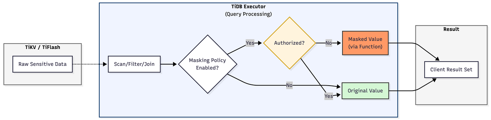
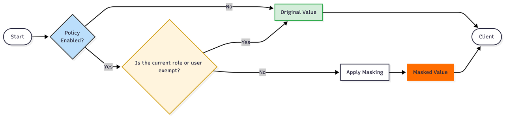
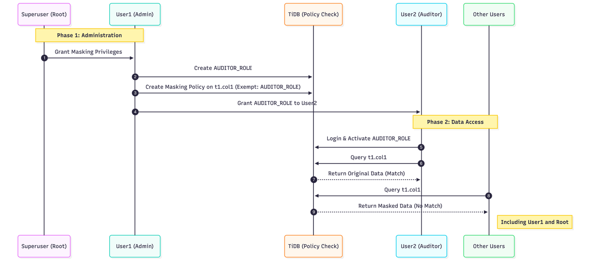

# Proposal: Server-side Column-Level Data Masking

- Author(s):     [@tiancaiamao](https://github.com/tiancaiamao)
- PM:            Frank (feature spec owner)
- Last updated:  2026-04-16
- Tracking:      FRM-2351
- Discussion at: https://github.com/pingcap/tidb/issues/65744

## Abstract

This proposal introduces server-side column-level data masking in TiDB.
Masking is defined as a policy bound to a table column and evaluated at query-result time.

The feature focuses on:

- Role/user-aware dynamic masking via SQL expressions.
- Built-in masking functions for common redaction patterns.
- DDL and metadata surfaces to create/alter/drop/inspect masking policies.
- Optional operation-level restriction controls (`RESTRICT ON ...`) for security-sensitive write/read transformations.

The goal is to protect sensitive data exposure while keeping application SQL behavior predictable.

## Background

Enterprises in regulated industries (for example workloads subject to the Payment Card Industry Data Security Standard (PCI DSS)) require strict control over who can view original column values (Primary Account Number (PAN), Personally Identifiable Information (PII), date attributes, etc.).
TiDB currently lacks native server-side column masking semantics and depends on application-side SQL function usage, which is hard to enforce consistently.

This proposal closes that gap with native masking policies enforced by TiDB.

## Design

### Goals

- Provide server-side column-level data masking in TiDB.
- Support conditional masking logic using session identity (`current_user()`, `current_role()`).
- Support full/partial/null/date masking patterns.
- Add SQL DDL and SHOW interfaces for full policy lifecycle management.
- Add optional operation restrictions with `RESTRICT ON`.
- Ensure masking metadata is persisted in system tables and visible for operations/audit.

### Non-goals

- Masking non-column data (logs, external backups, etc.).
- Masking virtual/generated columns.
- Full parity with Oracle syntax/API style.
- Global detached policy binding model (not adopted due to complexity and error risk).
- Managing cross-component user/role synchronization strategy for BR/TiCDC pipelines.

### Design overview



#### Policy model

The implementation treats masking policy as a table-owned schema object, not as a detached global object.
This is intentionally close to how engineers reason about index-like table attachments:
create table first, then attach policy, and let table lifecycle drive policy lifecycle.

Each policy record carries:

- logical identity (`policy_name`)
- target binding (`db/table/column`, plus `table_id/column_id`)
- masking expression
- optional `RESTRICT ON` operation set
- runtime status (`ENABLED` / `DISABLED`)

Key design constraints are:

- masking policy scope is per-table, not global
- `policy_name` uniqueness is enforced inside one table (`table_id + policy_name`)
- one column can have at most one policy (`table_id + column_id`)

Using per-table scope avoids global name collision and maps naturally to DDL ownership and cleanup logic.

#### Evaluation semantics

Masking is implemented as **AT RESULT** rewriting. Table data stays unchanged, ordinary relational processing uses raw base-column values, and masking is applied when producing query results.

From an execution perspective:

- planner/executor still use raw values for `JOIN`, `WHERE`, `GROUP BY`, `HAVING`, `ORDER BY`, set operators
- returned projection values are rewritten by policy expression based on runtime identity (`current_user()` / `current_role()`)

Subquery outputs consumed by an outer predicate are an exception: scalar, `IN`,
and quantified-comparison subqueries can mask their output before the outer
comparison. Relational operations inside the subquery still use raw values.
For example, comparing against a protected column's subquery output can match
its masked value, while comparing against `MIN`/`MAX` of that column uses the
raw aggregate result. Predicate outputs whose policy cannot be preserved
(including unsupported aggregates or correlated result shapes) retain their
raw values; each column of a row-valued result is handled separately.

A result expression over a protected column is rebuilt from the masked value
after sorting and filtering. An expression that has to be evaluated exactly once
and in its own place cannot be rebuilt, such as `RAND()`, variable assignments and the
advisory lock functions (`GET_LOCK`, `RELEASE_LOCK`, `RELEASE_ALL_LOCKS`,
`IS_FREE_LOCK`, `IS_USED_LOCK`). A query with such an expression over a
protected column in its result fields is rejected with "masking policy cannot be
preserved through mutable expression" while the policy is enabled, also for an
identity that reads the original value: the limit is on the query shape, not a
missing privilege. The same call in `WHERE` is not affected.

This choice minimizes optimizer/storage regressions and keeps compatibility risk lower than predicate-time rewriting.
The tradeoff is that raw values can still participate in write/read transformations unless restricted by `RESTRICT ON`.

### Architecture and lifecycle design

This section describes how the feature is expected to be wired in code, so implementation work can be split by ownership instead of by SQL statement list.

#### DDL write path

1. Parse DDL from either `CREATE MASKING POLICY ...` or `ALTER TABLE ... ADD/MODIFY/... MASKING POLICY`.
2. Resolve target table/column and run target/expression validation.
3. Persist policy metadata to `mysql.tidb_masking_policy` as the Single Source of Truth (SSOT).
4. Emit schema change (`ActionCreateMaskingPolicy` / `ActionAlterMaskingPolicy` / `ActionDropMaskingPolicy`).
5. Invalidate policy cache in `InfoSchema`; actual policy rows are reloaded lazily on next access.

#### Query read path

1. Build plan with current statement `InfoSchema` (or stale/snapshot `InfoSchema` when applicable).
2. Resolve masking binding by `(table_id, column_id)`.
3. Rewrite result projection with masking expression (AT RESULT behavior). Plans with safely reusable masking expressions remain eligible for session and instance plan caches. Identity and role functions are deferred to the executing session, and cache hits revalidate `RESTRICT ON` checks for their source columns. Expressions with dependencies that cannot be safely reused bypass both plan caches and the session-local expression cache.
4. For restricted operations (`INSERT ... SELECT`, `UPDATE ... (SELECT ...)`, `DELETE ... (SELECT ...)`, `CTAS`), run restriction check against masked source columns before execution.

#### Metadata maintenance path

- `RENAME TABLE` / `RENAME COLUMN` updates policy metadata binding names while keeping ID-based binding continuity.
- `DROP COLUMN` / `DROP TABLE` performs synchronous policy cleanup in `mysql.tidb_masking_policy`.
- Guardrails on masked-column type/length/precision changes prevent policy/column divergence.

#### Component responsibilities

- Parser/AST: SQL grammar and AST nodes for policy DDL + `RESTRICT ON`.
- DDL: target validation, metadata writes, lifecycle synchronization, schema actions.
- InfoSchema: delayed loading and cache invalidation model for masking metadata.
- Planner/Executor: AT RESULT expression rewrite and restricted-operation enforcement.
- BR: backs up `mysql.tidb_masking_policy` with the other system tables but does not restore masking policies (see `BR backup and restore` below).

Primary code ownership map (for implementation navigation):

- Parser/AST: `pkg/parser/parser.y`, `pkg/parser/ast/ddl.go`
- DDL path: `pkg/ddl/executor.go`, `pkg/ddl/masking_policy.go`, `pkg/ddl/table.go`, `pkg/ddl/modify_column.go`
- InfoSchema loading/cache: `pkg/infoschema/masking_policy.go`, `pkg/infoschema/masking_policy_loader.go`, `pkg/infoschema/builder.go`
- Planner/executor behavior: `pkg/planner/core/point_get_plan.go`, `pkg/planner/core/masking_policy_restrict.go`, `pkg/executor/show.go`
- BR: `br/pkg/restore/snap_client/systable_restore.go` (the policy table is not restored)

#### BR backup and restore

BR behavior in 8.5:

- BR backs up `mysql.tidb_masking_policy` like the other system tables, whenever the table filter selects it (a full backup does by default).
- A snapshot restore does not restore masking policies. It skips `mysql.tidb_masking_policy`, also with `--with-sys-table`: it does not create or change any policy on the target cluster, and policies that already exist there are kept as they are.
- An incremental restore does not apply masking policy DDL. An incremental backup can record `CREATE`, `ALTER` and `DROP MASKING POLICY` jobs. These jobs identify the target table but do not carry the database or table metadata that incremental restore uses to select DDL for replay, so it never replays them, even when it restores that table. Operators must apply policy changes made after the base backup on the target cluster themselves. Incremental backup is deprecated.
- A backup with backup schema version 3, which development builds of this feature wrote for backups with masking policies, is rejected before any data is imported: BR supports at most version 2.
- A snapshot restore brings back table data only. A restored table has no masking policy unless one is created on the target cluster.
- Point-in-time recovery does not rebuild the policies of the source cluster on the target cluster either. This says nothing about the content of a log backup: log backup records the changes of the whole data key range, so its raw files may contain masking policy data and must be protected like the protected data itself.

Reason: each row of `mysql.tidb_masking_policy` binds a policy to a table ID and a column ID. Restored tables and columns can get different IDs, so copying the rows would bind policies to the wrong objects.

Deployment prerequisite:

- Masking on a target cluster depends on the policy existing on that cluster. Before opening restored tables to users, the administrator recreates the masking policies there, together with the roles and users that the policy expressions refer to. `SHOW MASKING POLICIES FOR <table_name>` on the source cluster lists the definitions of a table.
- After that, verify with an ordinary account that the protected columns return masked values.
- If a policy exists on the target cluster but the exempt users or roles do not, the masked columns return redacted data to all users.

### SQL interface (reference)

#### Create / add policy

```sql
CREATE [OR REPLACE] MASKING POLICY [IF NOT EXISTS] <policy_name>
  ON <table_name> (<column_name>)
  AS <masking_expression>
  [RESTRICT ON <operation_list>]
  [ENABLE | DISABLE];
```

```sql
ALTER TABLE <table_name>
  ADD MASKING POLICY <policy_name> ON (<column_name>)
  AS <masking_expression>
  [RESTRICT ON <operation_list>]
  [ENABLE | DISABLE];
```

Rules:

- `OR REPLACE` and `IF NOT EXISTS` are mutually exclusive.
- Temporary tables, system tables, and views are not supported.
- One policy per column (`table_id + column_id` uniqueness).
- Policy name uniqueness is table-scoped (`table_id + policy_name`).
- `CREATE MASKING POLICY` and `ALTER TABLE ... ADD MASKING POLICY` are equivalent creation entry points (same internal object model and runtime behavior).
- The only user-visible syntax difference is that `OR REPLACE` / `IF NOT EXISTS` are available on `CREATE MASKING POLICY`.

#### Alter policy

```sql
ALTER TABLE <table_name> ENABLE MASKING POLICY <policy_name>;
ALTER TABLE <table_name> DISABLE MASKING POLICY <policy_name>;
ALTER TABLE <table_name> DROP MASKING POLICY <policy_name>;

ALTER TABLE <table_name>
  MODIFY MASKING POLICY <policy_name>
  SET EXPRESSION = <new_sql_expression>;

ALTER TABLE <table_name>
  MODIFY MASKING POLICY <policy_name>
  SET RESTRICT ON <operation_list>;
```

#### Metadata observation

```sql
SHOW CREATE TABLE <table_name>;
SHOW MASKING POLICIES FOR <table_name>;
SHOW MASKING POLICIES FOR <table_name> WHERE column_name = '<column_name>';
```

Observation boundary:

`SHOW CREATE TABLE` is kept intentionally lightweight: it only tells operators that a policy exists on a column and whether it is enabled.
It does not try to serialize full policy definition.

Full policy inspection is delegated to `SHOW MASKING POLICIES`, which is the detailed operational surface for expression/restrict metadata.
This split keeps `SHOW CREATE TABLE` stable/readable while giving tooling a dedicated API for policy introspection.

### `RESTRICT ON` semantics

`operation_list` values:

- `INSERT_INTO_SELECT`
- `UPDATE_SELECT`
- `DELETE_SELECT`
- `CTAS`
- `NONE` (default)

Example:

```sql
RESTRICT ON (INSERT_INTO_SELECT, DELETE_SELECT)
```

At execution time, restricted operations are validated against source masked columns.
The check simplifies session-constant identity and role conditions and allows the operation only when the selected policy expression is the original column. Data-dependent conditions or other expressions whose identity cannot be established are rejected; sampled column values are never used to authorize access.
If not allowed, the statement is rejected with masking access-denied error.

`UPDATE_SELECT` also covers an `UPDATE` assignment that reads a masked column directly, without a subquery, such as `UPDATE dst JOIN src ON ... SET dst.c = src.c` or `UPDATE t SET c2 = c`: the assignment would write the original value, or a value computed from it, into another column or another row.
Such an assignment is validated like a restricted subquery and rejected with the same error; it is never rewritten to store the masked value. The same table under another alias is a different source.
The only exception is assigning a column to itself as is (`SET c = c`), which writes the same value into the same column of the same row. A value computed from the column and written back to the same column, such as `SET c = UPPER(c)`, is restricted like any other computed value. Columns that are only compared in `WHERE` or `JOIN ... ON` are not affected.
The assignments of `INSERT ... ON DUPLICATE KEY UPDATE` update the existing row and follow the same rule under `UPDATE_SELECT`: an assignment that reads a protected column of the existing row is rejected. The values of the new row (`VALUES(c)`), constants and unprotected columns are not restricted.

### Expression semantics

Policies use SQL expressions (typically `CASE WHEN`) and support identity checks based on:

- `current_user()`
- `current_role()`

Supported comparators include:

- `IN`
- `NOT IN`
- `=`
- `!=`

Default-deny behavior is recommended: users/roles not matching allow conditions should get masked results.

### Built-in masking functions

- `MASK_PARTIAL(col, preserve_left, preserve_right, mask_char)` - Partially masks string values while preserving both ends
  - Logic: Provides granular control for partial redaction of string data
  - Types: `VARCHAR`, `CHAR`, `TEXT`
  - `preserve_left`: Number of leading characters to keep
  - `preserve_right`: Number of trailing characters to keep
  - `mask_char`: Single character used for masking (e.g., '*', 'X')
  - Example: `MASK_PARTIAL(credit_card, 6, 4, '*')` keeps first 6 and last 4 characters

- `MASK_FULL(col)` - Masks entire column value completely
  - `col`: A string, temporal, floating-point, or decimal column. Ordinary integer columns (`INT`, `BIGINT`, including unsigned variants) are not accepted by `MASK_FULL`; use `MASK_NULL` or a custom policy expression for those columns. `YEAR` is accepted.
  - For datetime types: returns '1970-01-01' (date) or '1970-01-01 00:00:00' (datetime)
  - Example: `MASK_FULL(ssn)` returns 'XXXXXXXXX' for a 9-digit SSN

- `MASK_NULL(col)` - Returns NULL for the column value
  - `col`: The column to mask (any supported type)
  - Example: `MASK_NULL(salary)` always returns NULL

- `MASK_DATE(col, date_literal)` - Replaces date components with fixed values or a template
  - `col`: The date/time column to mask
  - `date_literal`: A date string (e.g., '1970-01-01'); `Y`, `M`, and `D` preserve the corresponding input component, and fixed components may omit leading zeroes.
  - Example: `MASK_DATE(birth_date, '1970-01-01')` returns '1970-01-01' for any date value

### Supported column types

Primary supported scope:

- String-like: `VARCHAR`, `CHAR`, `TEXT` family, `BLOB` family
- Temporal: `DATE`, `TIME`, `DATETIME`, `TIMESTAMP`, `YEAR`
- Numeric: integer / floating-point / decimal types

For `LONGTEXT` and `BLOB` types, required minimum behavior is:

- Full masking, or
- Null masking

### DDL guard and cascade drop

- DDL guard: type/length/precision modification on a masked column is blocked.
- Cascade drop: dropping a masked column (or its table) removes associated masking policy metadata synchronously.

This prevents policy/column divergence and security gaps.

### System table design

Masking metadata is stored in table:

- `mysql.tidb_masking_policy`

Reference schema:

```sql
CREATE TABLE mysql.tidb_masking_policy (
  policy_id bigint(64) NOT NULL AUTO_INCREMENT,
  policy_name varchar(64) NOT NULL,
  db_name varchar(64) NOT NULL,
  table_name varchar(64) NOT NULL,
  table_id bigint(64) NOT NULL,
  column_name varchar(64) NOT NULL,
  column_id bigint(64) NOT NULL,
  expression text NOT NULL,
  status varchar(16) NOT NULL,
  masking_type varchar(32) NOT NULL,
  restrict_on varchar(256) NOT NULL DEFAULT 'NONE',
  created_at datetime(6) NOT NULL,
  updated_at datetime(6) NOT NULL,
  created_by varchar(288) NOT NULL DEFAULT '',
  PRIMARY KEY(policy_id),
  UNIQUE KEY uk_table_policy(table_id, policy_name),
  UNIQUE KEY uk_table_column(table_id, column_id)
);
```

#### Design decision: Single Source of Truth (SSOT) in `mysql.tidb_masking_policy`

The storage design intentionally uses `mysql.tidb_masking_policy` as the only runtime source of truth.
Policy metadata is not duplicated into `TableInfo` and not maintained in a second metadata channel.

Why this direction:

- avoids dual-write ordering and recovery complexity leading to buggy implementation
- avoids "meta copy A vs system-table copy B" divergence handling
- tolerance of user misoperation like modify `mysql.tidb_masking_policy` directly
- keeps policy evolution logic concentrated in one path

This means policy is logically table-owned but physically stored in isolated system-table metadata (closer to privilege metadata storage style).
Stable binding is still preserved through `table_id/column_id`, so rename operations keep policy association intact.
On policy-related DDL, in-memory policy cache is invalidated and rebuilt on demand.

### InfoSchema loading model

There is a dependency cycle risk during bootstrap/schema construction:

- reading `mysql.tidb_masking_policy` needs SQL execution
- SQL execution needs usable `InfoSchema`
- eager policy materialization during initial `InfoSchema` build would re-enter that dependency

The implementation resolves this by delayed policy loading:

1. build base `InfoSchema` first
2. after base `InfoSchema` is usable, load policy rows through restricted SQL
3. materialize in-memory map keyed by `(table_id, column_id)`

This keeps initialization path acyclic while preserving runtime policy correctness.

### Snapshot / stale-read compatibility contract

Because policy metadata is externalized (not embedded in table meta), snapshot behavior must be explicitly defined:

For any statement executed at read timestamp `T`, policy state resolution and table schema resolution must observe the same timeline.
In practice, old schema + latest policy (or the reverse) is treated as invalid behavior.

Expected behavior for engineering and tests:

- no policy visible at `T` => no masking at `T`
- enabled policy visible at `T` => masking evaluated by policy definition at `T`

This contract is the compatibility baseline for `tidb_snapshot`, `AS OF TIMESTAMP`, stale transaction modes, and `tidb_read_staleness`.

### Authorization model



Masking policy administration uses dynamic privileges at global scope (`ON *.*`):

Policy creation and `ALTER TABLE` policy management also require `ALTER` on the target table. `CREATE OR REPLACE MASKING POLICY` requires both `CREATE MASKING POLICY` and `ALTER MASKING POLICY` in addition to the table privilege.

```sql
GRANT CREATE MASKING POLICY ON *.* TO 'security_admin'@'%';
GRANT ALTER MASKING POLICY ON *.* TO 'security_admin'@'%';
GRANT DROP MASKING POLICY ON *.* TO 'security_admin'@'%';
GRANT ALTER ON business_db.business_table TO 'security_admin'@'%';
```

| Privilege | Description |
| --- | --- |
| `CREATE MASKING POLICY` | Allows creating new policy objects and binding them to columns via `ALTER TABLE ... ADD MASKING POLICY` or `CREATE MASKING POLICY`. |
| `ALTER MASKING POLICY` | Allows modifying existing masking policy definitions, including `SET EXPRESSION`, `SET RESTRICT ON`, and `ENABLE` / `DISABLE`. |
| `DROP MASKING POLICY` | Allows permanent removal of masking policies from columns/tables. |

`ALTER MASKING POLICY` includes:

- `SET EXPRESSION`
- `SET RESTRICT ON`
- `ENABLE` / `DISABLE`

Runtime data exposure is still controlled by policy expression logic (`current_user()` / `current_role()` conditions), not by the DDL privilege itself.

### Operational workflow (example)



1. Security admin is granted masking-policy management privileges.
2. Admin creates a business role (for example `AUDITOR_ROLE`) for unmasked access.
3. Admin defines policy with role/user allow-list logic.
4. Admin grants the role to target users.
5. Authorized sessions with active role read raw values; others read masked values.

## Rationale

This design prioritizes predictable SQL behavior and lower rollout risk:

- Uses explicit SQL policy objects and expression-based rules, which are easy to audit and reason about.
- Keeps storage and predicate semantics unchanged (AT RESULT), reducing execution-path regressions.
- Uses per-column binding with stable internal IDs to survive rename operations.
- Adds optional `RESTRICT ON` controls to satisfy stricter compliance needs without forcing Oracle-like restrictions by default.

### Design tradeoffs

The chosen architecture has clear tradeoffs worth keeping explicit for maintainers:

- Externalized policy storage improves metadata consistency handling, but requires careful cache/snapshot coordination.
- AT RESULT masking keeps planner/storage behavior stable, but means data-flow restrictions must be handled explicitly through `RESTRICT ON`.
- Lightweight `SHOW CREATE TABLE` improves readability, but detailed tooling must use `SHOW MASKING POLICIES`.

### Example Usage

```sql
-- Example 1: MASK_PARTIAL - keep first 3 and last 3 characters of a phone number
CREATE TABLE contacts (
  id INT PRIMARY KEY,
  name VARCHAR(100),
  phone VARCHAR(20)
);

CREATE MASKING POLICY p_mask_phone
  ON contacts(phone)
  AS MASK_PARTIAL(phone, 3, 3, '*') ENABLE;

INSERT INTO contacts VALUES (1, 'Alice', '1234567890');
-- Query returns: '123****890' (masked in the middle)
SELECT phone FROM contacts WHERE id = 1;

-- Example 2: MASK_FULL - completely mask SSN
CREATE MASKING POLICY p_mask_ssn
  ON employees(ssn)
  AS MASK_FULL(ssn) ENABLE;

-- Query returns: masked SSN value
SELECT ssn FROM employees WHERE id = 1;

-- Example 3: MASK_DATE - normalize birth dates
CREATE MASKING POLICY p_mask_birthdate
  ON users(birth_date)
  AS MASK_DATE(birth_date, '1970-01-01') ENABLE;

-- Query returns: '1970-01-01' for any birth date
SELECT birth_date FROM users WHERE id = 1;

-- Example 4: MASK_NULL - hide salary information
CREATE MASKING POLICY p_mask_salary
  ON employees(salary)
  AS MASK_NULL(salary) ENABLE;

-- Query returns: NULL for all salary values
SELECT salary FROM employees WHERE id = 1;
```

## Compatibility

- Syntax and behavior are TiDB-specific (not MySQL-compatible feature parity).
- BR in 8.5 does not restore masking policies. Recreate the policies on the target cluster before opening restored tables to users (see `BR backup and restore`).
- Replication of masking policies by TiCDC is not part of this design and is not verified. Automatic masking on a downstream cluster depends on the policies, and the users and roles their expressions refer to, existing there.
- Runtime masking decisions depend on identity evaluation (`current_user()` / `current_role()`), so missing or diverged user/role state in downstream clusters can change effective masking behavior.
- Dump/validation tools may see masked values if executed by non-exempt users.

> **Caution**
> User/role synchronization behavior in BR/TiCDC is out of scope of this masking-policy design.
> This design only defines masking-policy semantics and metadata behavior.
> Therefore, downstream masking validation MUST treat user/role alignment as a hard prerequisite.
> If downstream user/role state is not explicitly reconciled and verified first, masking validation results MUST be considered invalid.
> Current behavior can vary by component, version, and flags/filters (for example, BR `--with-sys-table` and table filters; TiCDC system-schema filtering), so operators MUST verify actual downstream user/role state in each deployment.

## Implementation

This section is an implementation scope checklist. Architecture and lifecycle decisions are defined in `Architecture and lifecycle design` above.

High-level implementation scope:

- Parser/AST support for masking policy DDL and `RESTRICT ON` syntax.
- Metadata persistence in `mysql.tidb_masking_policy`.
- Planner/executor integration for AT RESULT masking expression evaluation.
- Privilege checks for policy management operations.
- SHOW/inspection surfaces (`SHOW CREATE TABLE`, `SHOW MASKING POLICIES ...`).
- DDL guard and cascade-drop hooks for masked columns.
- Plan-cache invalidation when masking bindings change.

Non-functional expectations:

- Minor read-latency overhead due to per-row expression and identity checks.
- Pushdown opportunities to TiKV/TiFlash should be benchmarked for batch workloads.

## Open issues

- Finalized error code selection for masking access denial in restricted operations should align with existing TiDB/MySQL error code allocation policy.
- Exact optimizer pushdown and plan-cache invalidation strategy should be validated by implementation benchmarks.
- FK-related inference risks require clear operational guidance in user-facing docs.

## References

- [PCI DSS v4.0.1](https://www.pcisecuritystandards.org/standards/pci-dss/) (Primary Account Number (PAN) display masking requirements)
- [Oracle DBMS_REDACT documentation](https://docs.oracle.com/en/database/oracle/oracle-database/21/arpls/DBMS_REDACT.html#GUID-61439993-CC76-40FF-AC6E-24A323947DA8)
- [IBM DB2 `CREATE MASK`](https://www.ibm.com/docs/en/db2/12.1.0?topic=statements-create-mask)
- [SQL Server Dynamic Data Masking](https://docs.microsoft.com/en-us/sql/relational-databases/security/dynamic-data-masking)
- [Snowflake masking policy syntax](https://docs.snowflake.com/en/sql-reference/sql/create-masking-policy)
