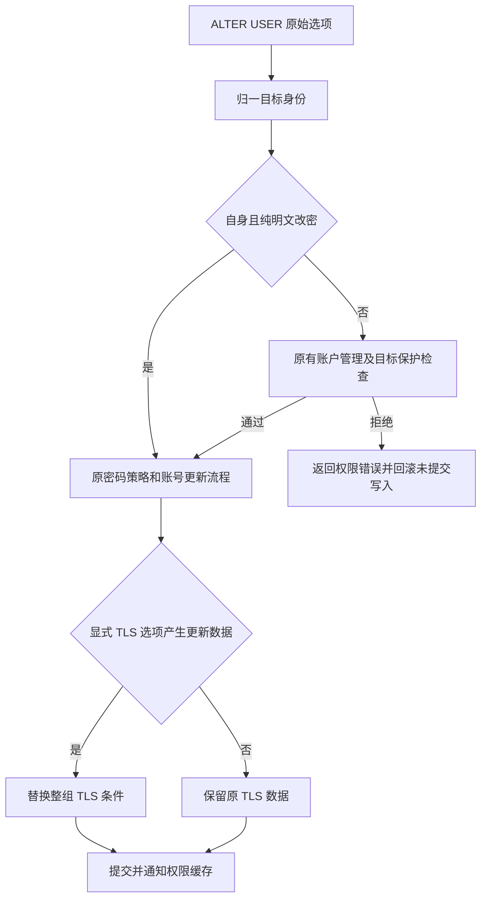

# TiDB 证书双因素账号维护修复技术 spec

Q10 后的定位：对应[历史证书候选方案](2026-11-18-multi-factor-authentication-certificate-candidate.md)，保留事实和修复思路；本稿不是原生 MFA 的技术 spec，不进入本次开发确认。当前产品方案见[原生 MFA 用户文档](2026-11-18-multi-factor-authentication-user-guide.md)。

状态：proposal v0.1，退出当前确认流程，保留为证书账号维护修复候选。用户要求重新核对证书方案与 MySQL 原生 MFA 的差异；这些已复现问题仍成立，但修复本稿不能交付 MySQL 原生 MFA，也不能单凭此确认客户需求满足。基线为 `release-7.1.9-0` / `5c980fb645c8f3ae76f006967a4bc8b28ce8ba26`；尚未创建开发分支或修改产品代码。IP 限制已关闭为完成项，后续不开发或追加讨论。

## 现状与修复目标

当前 TiDB 已能联合校验密码与账号绑定的客户端证书，已有精确 IPv4 地址及点分掩码网段控制。两轮独立实例验证各完成 27 项断言，20 项通过、7 项失败，失败集中在账号维护：

| 已复现问题 | 原因 | 拟修改行为 |
| --- | --- | --- |
| 普通改密、锁定再解锁后无需证书即可登录 | `executeAlterUser` 把未指定的 TLS 选项转换为 `{}` 并覆盖原配置 | ALTER USER 省略 REQUIRE 时保持原有 TLS 约束 |
| 普通用户可执行自身 `REQUIRE NONE` | 自身账号无条件绕过账户管理权限检查 | 自助豁免仅用于自身纯明文改密；修改证书条件执行管理权限检查 |
| 开启密码策略后，普通用户仍能通过 `WITH ... AS ''` 清空密码 | 同一权限豁免允许认证插件和认证串管理，AS 输入不走明文密码校验 | 插件选择和认证串导入须有管理权限；合法明文改密继续由原密码策略校验 |

这两处修改采用 MySQL 的属性更新和自助权限原则，适用于所有账号。证书双因素账号仍由管理员配置为非空密码、受支持的密码插件、issuer/subject 约束，并按已确认要求启用全局密码策略。

本次复用认证握手、TLS 验证、存储结构和 IP 匹配逻辑。MySQL 原生多因子插件链、每账号 MFA 开关、TOTP、自动证书吊销、代理认证、IPv6 网段及 CIDR 简写不进入实现范围。相关范围决定见用户文档。

## 执行流程

账号管理沿现有调用链执行：

1. Parser 生成 `ast.AlterUserStmt`；[SimpleExec.Next](/Users/cs/code/tidb/pkg/executor/simple.go:146)按既有 DDL 式规则提交调用者旧事务，再进入 `executeAlterUser`。
2. `executeAlterUser` 保留既有密码过期沙箱检查，并按现有逻辑将 `CurrentAuth` 归一为 `Specs`。对原始认证选项判断是否为纯改密，判断发生在默认认证插件被填入之前。
3. TLS 选项为空时跳过 `tlsOption2GlobalPriv`，让 `privData` 保持空；存在选项时调用现有转换函数，保留其校验和序列化语义。
4. 沿原路径取得系统会话，使用 READ-COMMITTED 和悲观事务。逐个目标解析自身身份、校验权限；只有自身纯改密可使用自助豁免。通过后才执行该目标的密码历史、用户属性和 TLS 属性更新。
5. 按既有规则提交或回滚整条语句；提交成功后调用 `NotifyUpdatePrivilege`。后续认证由原来的权限缓存、`checkSSL` 和密码插件验证处理。

多账号语句逐目标检查；不新增“必须只有一个目标”的限制。只要其中一个目标需要但缺少管理权限，就返回错误并回滚该语句此前的未提交写入。`IF EXISTS` 仍仅处理账号不存在，不豁免权限错误。

## 账号维护规则

### TLS 条件的更新

仅在 `executeAlterUser` 的调用处区分“未指定”和“显式指定”；共享的 `tlsOption2GlobalPriv` 保持原样，避免影响 CREATE USER 和 GRANT 调用者。

| 输入 | `mysql.global_priv.Priv` 的行为 |
| --- | --- |
| 没有 `AuthTokenOrTLSOptions` | 不写该字段，原值或原有无记录状态保持 |
| 只有 `TOKEN_ISSUER` | 转换函数沿现有路径返回空，不写 TLS；token 自身属性仍按原路径处理 |
| 显式 `REQUIRE NONE` | 有权限时按现有编码移除 TLS 要求 |
| 显式 SSL/X509/ISSUER/SUBJECT/CIPHER/SAN | 有权限时按现有编码替换整组 TLS 条件 |
| 重复或非法 TLS 条件 | 沿现有错误路径拒绝，账号数据不更新 |

显式 `REQUIRE SUBJECT ...` 仍只保留新语句指定的条件，不合并旧 issuer；这与所查 MySQL 行为一致。普通改密、密码策略修改、锁定/解锁以及其他省略 REQUIRE 的合法管理操作都应保留证书约束。

### 自助改密与管理权限

“自身”沿用当前身份比较：`CURRENT_USER`，或用户名与会话已认证的 `AuthHostname` 均匹配。不能仅按用户名判断，同名不同 Host 是不同账号。

“纯明文改密”使用现有 AST 的以下条件联合判定：

| 项目 | 条件 |
| --- | --- |
| `spec.AuthOpt` | 非 nil |
| `AuthOpt.ByAuthString` | true |
| `AuthOpt.AuthPlugin` | 空，尚未被执行器补入当前插件 |
| `s.AuthTokenOrTLSOptions` | 空，包含 TOKEN_ISSUER 在内的选项均排除 |
| `s.ResourceOptions`、`s.PasswordOrLockOptions` | 均为空 |
| `s.CommentOrAttributeOption`、`s.ResourceGroupNameOption` | 均为 nil |

`IfExists` 不改变改密分类；密码字符串是否为空由原密码策略处理，权限判定不重复密码强度校验。当前 AST 将 `WITH '' BY ...` 的空插件名与未指定插件都表示为空字符串，执行器均补为原插件；本次保留此等价行为，不新增 parser 标记。`WITH '' AS ''` 仍因不属于明文 BY 路径而需要管理权限。

不满足“自身且纯明文改密”时，要求现有有效的 `CREATE USER` 或对 `mysql.user` 的 `UPDATE` 权限，继续调用既有权限检查器并使用当前生效角色。普通用户不能自行更换证书要求、指定有效认证插件名、导入认证串，也不能把账号策略、锁定、资源或元数据修改附加到自助改密中。

修改他人账号的 SYSTEM_USER、SEM restricted user 保护保持现有边界；自身纯改密豁免保持。MAX_USER_CONNECTIONS 已有的额外 CREATE USER 限制保留。权限检查继续经过 SEM、三权分立和 extension 的现有判断，不直接读取用户表中的静态权限位。

合法的自身 `ALTER USER ... IDENTIFIED BY ...`、`ALTER USER USER() IDENTIFIED BY ...` 和 `SET PASSWORD` 继续可用。显式指定有效插件名的 `WITH plugin BY ...` 即使插件与当前相同，也按管理操作处理；用户可改用前述自助语法。管理员的插件选择、AS 认证串导入、显式 REQUIRE 和密码策略管理能力保留。

## 模块、接口与数据

| 模块与接口 | 状态 | 职责、调用者与修改边界 |
| --- | --- | --- |
| `ast.AlterUserStmt` / `AuthOption` | existing | Parser 表达输入选项；执行器读取原始选项。字段与语法不变 |
| `SimpleExec.executeAlterUser` | changed | `SimpleExec.Next` 调用；调整 TLS 更新触发条件及自身权限豁免，其余流程复用；失败返回现有错误 |
| `tlsOption2GlobalPriv` | existing | 将显式选项校验并编码；仍由 CREATE/ALTER/GRANT 相关路径调用，不承担权限判断，保持实现和返回约定 |
| `RequestVerification` / 动态权限检查 | existing | 执行器查询管理权限与目标保护；保持角色、SEM、extension 语义 |
| `BaseExecutor.ReleaseSysSession` | existing | 执行器 defer 调用；回滚后归还会话，回滚失败关闭会话 |
| `Domain.NotifyUpdatePrivilege` | existing | 提交成功后通知账号缓存；保留跨节点传播机制 |
| `ConnectionVerification` / `checkSSL` | existing | 登录与重新认证使用账号缓存执行密码及 TLS 检查；本次不修改 |

默认将两项判定直接放入既有执行器，不引入新接口、权限框架、服务或状态机。产品修改预计集中在 `pkg/executor/simple.go`，其余改动为测试与文档；实施中如发现必须改变协议、parser 或存储模型，应先回到文档确认。

存储继续使用 `mysql.user` 的凭据、插件及账号属性，以及 `mysql.global_priv.Priv` 的现有 TLS JSON。没有 schema/bootstrap 升级，也不写入新的 MFA 字段。省略 REQUIRE 时不重新序列化原有 JSON，以完整保留既有数据。

## 错误、事务与缓存

权限不足沿用 `ErrSpecificAccessDenied`（1227）；密码策略、密码历史、非法 TLS、账号不存在继续返回原有错误。失败不放宽认证条件，不新增重试或降级路径。

[ReleaseSysSession](/Users/cs/code/tidb/pkg/executor/internal/exec/executor.go:398)会对未提交内部事务执行 rollback，因此逐目标权限拒绝可以直接返回错误。此原子性只覆盖本次内部数据库写入；调用者原事务已按现有规则隐式提交，既有 extension 事件也不能据此声称具备事务性。

只有内部 commit 成功才通知权限缓存。如果提交后通知失败，数据库写入已提交，不能报告为已回滚；保留现有错误语义，运维核对持久化配置并逐节点验证。账号更新对后续认证生效，已建立会话的处理沿用用户文档中的管理员流程。

## 兼容性与部署

影响范围是所有账号的 ALTER USER 行为，不只证书账号。明确的变化有：省略 REQUIRE 保留 TLS 条件；普通用户原先被误放行的非纯改密操作开始返回权限错误。合法自助改密、原有单因子登录、管理员认证串导入、显式 REQUIRE 替换语义保持。全局密码策略由管理员按已确认流程启用，代码不自动更改策略或历史账号密码。

升级所有可接收账号管理语句的 TiDB 节点后再承诺维护保障。旧节点仍可能清除证书要求或放行自助管理；升级也无法自动恢复已被清除的绑定和密码，应核对并重新配置目标账号。具体启用、恢复和回退流程引用用户文档，不增加新的迁移服务或后台任务。

## 验证计划

当前只执行了基线验证，以下为开发后的必做检查；不能将计划写成已经通过。

| 验证层 | 用例与风险 |
| --- | --- |
| 账号更新 | 配置 TLS 后分别改密、锁定/解锁、修改密码策略及合法其他属性，原约束保持；原无 TLS 记录的账号也正常更新 |
| 显式更新兼容 | REQUIRE NONE 清除、ISSUER/SUBJECT 完整替换、仅 SUBJECT 不保留旧 issuer；TOKEN_ISSUER-only 保留 TLS；CREATE/GRANT 原有行为保持 |
| 自助权限 | 普通账号合法 BY 改密成功；WITH plugin BY、WITH plugin AS、裸 WITH、REQUIRE、账号策略/锁定、资源、COMMENT/ATTRIBUTE、resource group、TOKEN_ISSUER 单独或与改密组合均要求管理权限 |
| 身份与授权 | USER()/CURRENT_USER 与明确账号身份、同名不同 Host、角色授权管理权限、mysql.user UPDATE、SYSTEM_USER/SEM 和三权分立既有测试；MAX_USER_CONNECTIONS 独立限制 |
| 事务与错误 | 多账号前项产生更新、后项权限失败时持久化数据和缓存无部分修改；IF EXISTS 不吞权限错误，账号不存在的原有处理保持 |
| 密码旧行为 | 开启策略时空 BY/SET PASSWORD 拒绝；管理员 AS 导入保持；密码历史和过期沙箱下的合法自身改密保留；未启用策略的原单因子账号行为保持 |
| 实际直连认证 | 使用新 TCP 连接验证正确密码＋证书成功；缺少任一因素、错误密码、错误主体/签发者、不受信任、过期/未生效、私钥缺失均失败；维护后重复验证 |
| 密码插件 | 覆盖用户文档列出的 native、caching_sha2、SM3；客户端选择与实际支持匹配，记录各自客户端和版本 |
| 重认证 | COM_CHANGE_USER 仍校验目标账号密码与当前连接证书，失败保留原身份；COM_RESET_CONNECTION 沿原已认证身份语义 |
| 生命周期 | 新主体绑定生效后旧主体证书失败；普通同身份续期仍允许尚有效旧证书；既有会话不会自动断开；TLS reload 成功及默认失败回退保持 |
| 多节点 | 共享同一存储的两个 TiDB 节点，修改账号后逐节点验证新约束生效；TLS reload 在两个节点分别执行验证，不使用两个独立 unistore 冒充集群 |
| 原有单因子连接 | 普通单因子账号的原 TLS/明文路径回归 |

优先在现有测试文件补回归：`pkg/executor/test/simpletest/simple_test.go`、`pkg/executor/test/passwordtest/password_management_test.go`、`pkg/privilege/privileges/privileges_test.go`、`pkg/server/tests/tls/tls_test.go`。采用真实 SQL 和身份检查，断言配置及实际认证结果；不为不可由 parser 产生的 AST 组合堆测试。

开发顺序为：先加入能复现上述缺口的回归并确认失败，再做最小实现，运行相关包测试及本次诊断脚本，最后完成上表未覆盖的发布验证。已通过测试只在新增变更或失败需要时重跑。多节点等环境若暂不具备，应明确记录阻塞与缺失证据，不将单节点结果当作完整验收。

## 确认与实施

本稿仅设计两项证书账号维护修复，设计依据见[设计审阅记录](2026-11-18-multi-factor-authentication-spec-review.md)。当前先重新讨论 MFA 产品范围，上一轮 Q9 暂不作为开发确认入口；需按最终用户方案重新审视本稿的适用性和交付范围。

用户确认后，在当前目录从上述基线创建 `fix/mfa-account-auth` 分支开始开发，不创建 worktree。若开始时 HEAD 或工作区发生变化，先核对并保留其他修改；不覆盖已有分支或用户改动。
