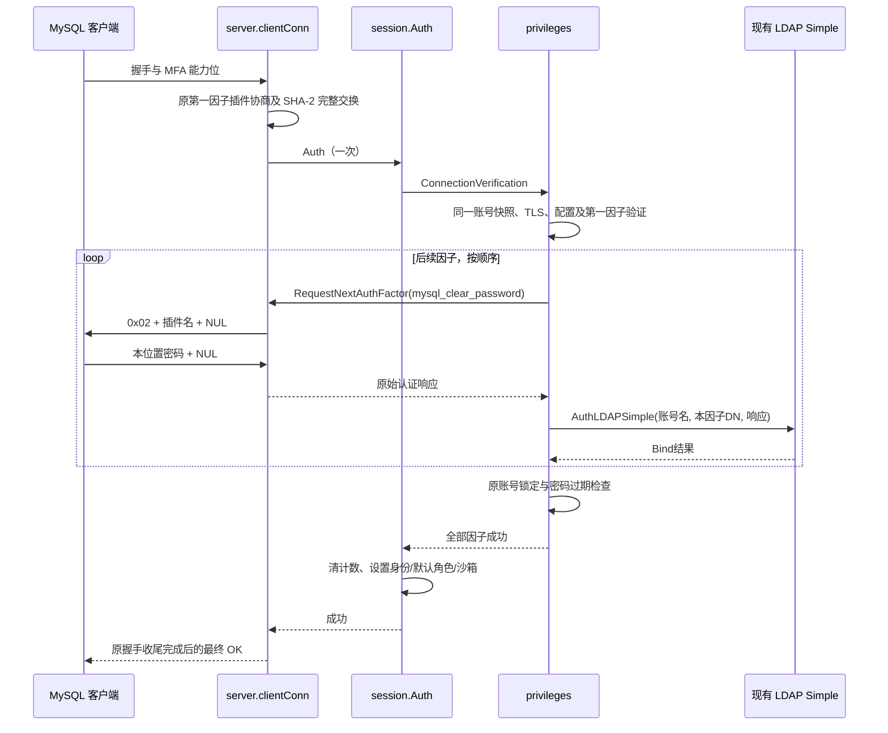

# TiDB 原生 MFA 技术 spec

状态：proposal v0.4，按 Q18 提出的旧行为保护与 clean code 要求收紧；Q19 已确认按此边界开发。Q17 已确认逆序双 MODIFY 按明确因子编号稳定更新，并记录与 MySQL 8.4.9 异常行为的差异。需求基线为用户在 Q15 整体确认的[用户文档 v0.5](2026-11-18-multi-factor-authentication-user-guide.md)，包含 Q14 确认的 LDAP 服务账户密码日志脱敏最小修复。实现位于当前目录 `mfa-native-support` 分支，验证状态见第 10 节及交付报告。

代码基线：TiDB `release-7.1.9-0` / `5c980fb645c8f3ae76f006967a4bc8b28ce8ba26`；MySQL 参照为 `mysql-8.4.9` / `f9c88132a87a7d9e740e50bce2621999695bd3fe`，基础策略同时核对 8.0.27。开发须等本文单独确认后，在当前目录创建分支；不创建 worktree。

## 1. 目标、基线与不变量

交付最多三个有序认证因子的账号管理、持久化、登录协议、基础 `authentication_policy` 和策略管理员语义。第一因子为 native 或 caching SHA-2，后续因子为现有 LDAP Simple；每个后续因子保存自己的 LDAP DN，共用现有 LDAP Simple 全局连接配置。

[现有能力实测](2026-11-18-authentication-runtime-validation.md)已经证明 LDAP Simple、StartTLS、LDAPS、目录改密和连接复用可用；本次复用 `AuthLDAPSimple`。新增框架不重新实现 LDAP、CA 管理或密码算法，不增加 WebAuthn、注册、无密码登录、SASL MFA、extension MFA、代理迁移支持及 MySQL 8.4 的 `*:plugin`/自动补齐因子。

| 当前实现 | 本设计的扩展位置 |
| --- | --- |
| [UserSpec](/Users/cs/code/tidb/pkg/parser/ast/misc.go:1495)只保存第一 AuthOpt，账号语法共享于部分 GRANT/REVOKE | 保留 AuthOpt；仅在 CREATE/ALTER USER 专用产生式增加后续因子 |
| [CREATE/ALTER](/Users/cs/code/tidb/pkg/executor/simple.go:1186)写第一插件、认证串及 User_attributes | 第一因子字段保持；在现有 JSON 保存后续因子 |
| [ConnectionVerification](/Users/cs/code/tidb/pkg/privilege/privileges/privileges.go:712)验证一个插件 | 在同一次验证内顺序执行全部因子 |
| [session.Auth](/Users/cs/code/tidb/pkg/session/session.go:2922)成功后清计数、授予身份与角色 | 仍只调用一次；全部因子成功后才进入原成功收尾 |
| [AuthConn](/Users/cs/code/tidb/pkg/privilege/conn/conn.go:20)已暴露给 extension | 保持旧接口，增加仅 MFA 使用的可选传输接口 |

必须保持以下不变量：

1. 一次认证使用一个账号配置快照，按第一、第二、第三顺序验证；任一失败不得进入正常 SQL 会话或取得目标账号权限。
2. 第一因子成功不清零失败计数、不启用密码过期沙箱、不提交 SessionVars.User/ActiveRoles；这些仍由完整认证后的原收尾执行。
3. 缺少后续因子键表示原单因子；存在但损坏的配置表示该账号不可认证，不能退回第一因子或同名更宽 Host 账号。
4. 账号更新与密码历史、TLS、其他 JSON 属性在原有系统表事务内保持一致；缓存发布发生在提交之后。
5. 无 MFA 的旧账号继续走原插件、默认客户端和认证路径。新增策略为管理员显式设置后的约束，默认 `'*,,'` 不追溯改造旧账号。

### 1.1 MySQL 对齐合同

本次新增能力沿用 MySQL 的账号 SQL、认证包和 MFA 持久化格式；首版插件与策略子集以 Q11/Q12/Q15 为界。以固定的 MySQL 8.4.9 源码和实测作为行为基线，8.0.27 用于核对共有格式与基础策略。实现复用 TiDB 的 Go 模块、系统表事务和分布式权限缓存，不照搬 MySQL C++ 类，也不因此新增用户语法或私有 MFA 存储格式。

| 对齐面 | 合同及实现参考 |
| --- | --- |
| SQL 与因子管理 | 采用 AND IDENTIFIED、ADD/MODIFY/DROP FACTOR 和原有 SHOW CREATE USER；参考 [MySQL 文法](/Users/cs/code/mysql-server/sql/sql_yacc.yy:16848)、[因子操作](/Users/cs/code/mysql-server/sql/auth/sql_mfa.cc:63)，不增设 MFA 专用 SQL |
| 系统表与 JSON | 第一因子保留 user 原列，后续因子使用同名 User_attributes 子文档；参考 [MFA 读写](/Users/cs/code/mysql-server/sql/auth/sql_mfa.cc:731)，具体映射见第 4 节 |
| policy 与权限 | 参考 [策略检查](/Users/cs/code/mysql-server/sql/auth/sql_user.cc:1101)及[显式动态授权](/Users/cs/code/mysql-server/sql/auth/sql_security_ctx.cc:702)；不设计另一套权限模型 |
| 登录协议 | 参考 [MySQL 多因子循环](/Users/cs/code/mysql-server/sql/auth/sql_authentication.cc:3640)与[客户端凭据位置推进](/Users/cs/code/mysql-server/sql-common/client.cc:6064)，全部因子通过后才完成认证 |
| TiDB 既有差异 | 默认第一插件、变量持久化与集群传播、TLS 存储、锁定统计时机、密码过期沙箱及 LDAP 错误映射继续复用，见第 4–6 节；不称完整 MySQL 行为等同 |
| 异常数据安全边界 | 坏配置保留账号匹配位置并拒绝认证；拒绝超范围的注册/无密码状态及超长数组。此项与 MySQL 直接修改系统表后的行为有差异，见第 4、11 节，须随技术稿确认 |

### 1.2 旧行为保护与最小改动边界

兼容基线是本分支现有行为。对未配置 MFA、未使用新因子语法、policy 为默认 `'*,,'` 的账号，保留原认证、改密、权限、TLS、错误码、锁定统计、会话恢复及系统表写入语义。新增逻辑嵌入必要的共享入口，旧分支不借此统一重构或修复历史问题。管理员显式添加 MFA 或设置非默认 policy 后，才产生对应新约束；将 policy 恢复为默认即采用默认规则，不记录额外的“曾启用”状态。

| 接入位置 | 本次必要增量 | 旧行为保护 |
| --- | --- | --- |
| 系统表 | 账号 JSON 增加 MySQL 同名 MFA 成员；新变量/权限使用现有表 | 无新表、列、索引、列类型/默认值变更，无 bootstrap 数据迁移；不规范化旧账号整行 |
| Parser/AST | CREATE/ALTER 专用因子语法及附加字段 | 保留旧 AuthOpt、EncodedPassword 签名和第一因子语法；GRANT/REVOKE/ROLE 语法不扩展 |
| 账号执行器 | 按账号添加因子 patch、MFA 管理检查及新 policy | 原权限检查仍在原位置；旧单因子编码、回调次数和 JSON/TLS 更新规则保持 |
| 首次握手 | 宣告已有定义的 MFA capability 位；MFA 账号追加 0x02 交换 | 原插件选择、SHA-2/SM3 交换和客户端兼容分支保持；单因子不增加认证轮次 |
| session/privileges | 有 MFA 时验证因子链；新增 MFA 失败计数原因 | 保留旧失败字段及置位条件；原单因子错误、锁定和沙箱时机不重写 |
| CHANGE_USER | 仅目标 MFA 的 SHA-2 完整交换和认证失败断连 | 不抽取共用首因子准备器；原无 MFA 的交换、错误和旧会话恢复保持 |
| 会话迁移 | 当前精确账号含 MFA/无效 MFA 时拒绝，目标端防止 token 绕过 | 缺失账号、无用户或无 manager 的旧导出路径保持；RESET/definer 不加限制 |
| LDAP 配置日志 | Q14 已批准的 Simple/SASL 服务账户密码脱敏 | 只改变内置日志/安全文本，真实设置、回调、持久化、SHOW 及 LDAP 行为不变 |

全局可见的必要变化有三类：握手增加能力位；新增变量/权限/语法可被发现和使用；已批准的两项 LDAP 密码配置日志脱敏。初始握手尚未得到用户名，能力位无法只向 MFA 账号宣告；它是协议能力扩展，必须通过旧客户端回归，不能承诺握手报文完全相同。显式设置非默认 policy 会约束已有单因子的 CREATE/ALTER/SET PASSWORD，这是新功能作用范围，不是升级后的默认变化。

保持 `NO_AUTO_CREATE_USER` 关闭时 GRANT 隐式建用户的既有路径；它不进入新 policy 检查。policy 的首版承诺入口为 CREATE USER、ALTER USER、SET PASSWORD，不能描述成覆盖所有可写账号的入口。直接系统表写入及恢复也不转换成这些账号语句；实际登录仍按账号存储的因子验证。

## 2. 执行流程

### 2.1 账号管理

1. Parser 保留原始认证选项和因子操作；在默认插件填充前判断自助改密资格及显式修改意图。
2. 原有非本人管理权限、SYSTEM_USER/SEM 等检查保留在原锁行前位置；显式因子操作先检查已知的管理权限，不让原本应直接拒绝的请求进入锁等待。CREATE ROLE、DROP USER、RENAME USER 不增加 MFA policy 检查。
3. SimpleExec 对相关账号语句读取一次 policy。CREATE 为每个账号分别构建后续因子；ALTER 在原 READ-COMMITTED 悲观事务中，从锁定行读取第一插件及原 User_attributes。只有依赖“当前是否 MFA”的本人豁免补判留在此处，不能整体后移旧权限检查。
4. 按第 5 节的默认 policy 边界保留旧单因子路径；进入新路径后检查因子结构、支持组合及策略，再沿原编码和系统表事务更新。后续 LDAP 单独处理，策略例外不豁免其余检查。
5. 按原有多账号事务提交或回滚。提交成功后调用 NotifyUpdatePrivilege；SHOW 和后续登录读取持久化后的配置。

CREATE 继续在循环外构建公共 metadata/resource/Password_locking 属性；仅在循环内为当前账号添加其 MFA 成员，不重写整个 attributes builder。无 MFA 的 CREATE 保留原写入，包括无属性时的 `{}`。ALTER 的 `newAttributes` 只生成一份 JSON patch，MFA 与 metadata、resource_group、Password_locking 合并更新；不能出现多个相互覆盖的 user_attributes 赋值。

[deletePasswordLockingAttribute](/Users/cs/code/tidb/pkg/executor/simple.go:1045)可能将整列设为 NULL。因此“新增 MFA＋清除最后一项 Password_locking”的同语句必须根据更新后的其他属性判断是否可置 NULL，保证新因子不被清空；“删除最后 MFA＋清最后 Password_locking”也以最终属性判断。此调整仅用于 MFA 参与的语句，不重写普通单因子清锁逻辑。

### 2.2 首次连接



错误从发生位置直接返回，后续循环停止。LDAP 的连接获取、服务账户预绑定、用户 Bind、归还池及既有重试均由原 LDAP 实现负责；MFA 层不再重试整个因子链。

第一次握手的最终 OK 仍位于 [handshake](/Users/cs/code/tidb/pkg/server/conn.go:328) 的原位置，晚于认证、初始数据库及 init_connect；不能在第一因子后发送中间 OK。

## 3. SQL、因子操作与权限

### 3.1 AST 与语法

保持 `UserSpec.AuthOpt` 表示第一因子。新增创建用的 `AuthFactors []*AuthOption`，以及 ALTER 用的 `AuthFactorOptions []AuthFactorOption`；后者只含 Action（Add/Modify/Drop）、Factor（2/3）和 AuthOpt（DROP 为空）。不引入注册状态或通用认证工作流对象。

CREATE USER 支持两个或三个 IDENTIFIED 子句，以 AND 连接。ALTER USER 支持同一账号的一次或两次同类 ADD/MODIFY/DROP 操作；使用 MySQL 的空格衔接方式，逗号仍分隔账号。混合 ADD/DROP/MODIFY、与第一 IDENTIFIED 子句不被 MySQL 文法接受的组合、注册语法和超过三个因子均明确拒绝。原 GRANT/REVOKE/CREATE ROLE 的产生式保持原状。后续认证项采用非空的 BY/WITH/AS 专用子集，不直接复用包含空产生式及 IDENTIFIED BY PASSWORD 的旧 AuthOption 非终结符。

后续 LDAP 因子遵循插件认证串含义：`WITH authentication_ldap_simple AS 'DN'` 和 `WITH ... BY 'DN'` 中的字符串均表示目录身份，不是 LDAP 密码；省略 BY/AS 或使用空串表示沿用原插件的用户名搜索。新增后续因子不能调用当前会把 LDAP BY 输入当成本地密码散列的通用 EncodedPassword 路径。原有 LDAP 单因子 BY 行为不在本次顺带修改，用户示例继续使用 AS。

省略后续 WITH 而使用 `IDENTIFIED BY 'DN'` 时，仅在 policy 对应位置明确指定 LDAP Simple 时解析出该插件；星号或可选空位没有后续默认插件，报 policy mismatch。基础具体插件名的解析不等于 MySQL 8.4 的 `*:plugin` 默认机制。

Restore 保留完整语义及顺序；SecureText 覆盖所有新认证选项，不能因为密码位于第二/第三因子而漏过脱敏。更新 parser 源、生成文件、AST Restore/安全格式化测试和相应构建清单。

### 3.2 原始序号与原子性

| 操作 | 规则 |
| --- | --- |
| ADD 2 | 原账号只有第一因子时可用；已有第二因子则 4056 |
| ADD 3 | 必须已有第二因子，或同语句先 ADD 2；先 ADD 3 后 ADD 2 报 4062 |
| MODIFY 2/3 | 按语句开始时的因子编号修改指定位置；不存在则 4057。正序、逆序双项均按 2、3 保存，兼容例外见下文 |
| DROP 2 | 两因子账号变为单因子；三因子账号的原第三因子前移 |
| DROP 3 | 删除第三因子，保留前两项 |
| 同语句 DROP 2 和 DROP 3 | 按语句开始时的序号标记，再统一删除；两种输入顺序均删除原第二、第三因子 |
| 同语句重复操作同一序号 | 4063；不解释为插件名或 DN 不可重复 |
| 单条多操作/多账号失败 | 整条系统表事务回滚；IF EXISTS/IF NOT EXISTS 只保留原有缺失/已存在账号的警告语义 |

Q17 已确认：所有 MODIFY 均按明确因子编号更新，先验证各操作的原始目标位置，再合并并按 2、3 序列化。`MODIFY 3 ... AS 'new-3' MODIFY 2 ... AS 'new-2'` 的结果为 `[new-2,new-3]`；后续 MODIFY 2 为 next-2，结果始终为 `[next-2,new-3]`，不受是否重载影响。AST 保留输入顺序，持久化、SHOW 与登录使用规范后的因子顺序，不引入额外序号字段或缓存状态。

这是明确接受的兼容例外。MySQL 8.4.9 的实测异常为：

| MySQL 操作链 | 实际 JSON 与 SHOW 顺序 |
| --- | --- |
| 先 MODIFY 3 为 new-3，再 MODIFY 2 为 new-2 | `[new-3,new-2]` |
| 上述语句后不重载，立即 MODIFY 2 为 immediate-2 | `[immediate-2,new-3]` |
| 上述逆序语句后先 FLUSH，再 MODIFY 2 为 after-reload-2 | `[after-reload-2,new-2]` |

原因是 MySQL 从 [ACL 内存副本](/Users/cs/code/mysql-server/sql/auth/sql_user.cc:1940)合并因子，双项修改可能保留与数组位置不同的内存序号，而[重载](/Users/cs/code/mysql-server/sql/auth/sql_mfa.cc:768)按数组下标重新赋序号。当前 TiDB 方案从锁定的持久化行计算更新、提交后刷新缓存，仅复制逆序数组只能得到 MySQL 重载后的结果。

按 Q17 的决定，保持 MySQL SQL 及 JSON 格式，继续从锁定的持久化行计算更新；不复制上述内存序号与重载相关异常。该差异须在最终用户文档及兼容测试中保留，证据见审阅记录。

SET PASSWORD 和只改第一因子的 ALTER 保留后续因子；RENAME 保留显式 DN，DROP 随用户行删除 JSON。密码历史继续只管理本地第一因子，LDAP 用户密码仍由外部目录管理。

### 3.3 权限与属性保持

所有新因子操作都要求原有账号管理权限，即使目标是本人也不能走旧的无条件自助豁免。当前或目标配置包含 MFA 时，仅“本人、未显式 WITH/AS 的第一因子 BY 改密、无额外管理选项”使用自助权限；切换插件、导入认证串、因子变更及混合管理操作执行管理权限检查。过期密码沙箱也只允许合法改密，不能借同时改密删除后续因子。

继续使用现有角色、SYSTEM_USER、RESTRICTED_USER_ADMIN、SEM 和资源限制权限检查，不以 mysql.user 的静态位替代现有权限接口。新增 policy 例外还须保留 extension 的动态权限附加检查，见第 5 节。普通单因子账号且无 MFA 操作时保留其既有权限路径；本次不整体实施历史证书 spec 的自助权限调整。

对当前含 MFA 或本次增加 MFA 的账号，ALTER 省略 REQUIRE 时跳过原会写入 `{}` 的 TLS 更新；显式 REQUIRE 沿既有整组替换规则处理。删除最后因子的本次语句也保留未显式修改的 TLS 条件。该判断逐账号执行，不修改循环外共享的 TLS patch；同一 ALTER 混合 MFA/单因子账号或交换账号顺序时，单因子部分仍走原路径。非 MFA 旧路径的证书维护问题保留为历史独立问题，本次不扩大修复范围。

## 4. 持久化、缓存与 SHOW

### 4.1 系统表映射

| 数据 | MySQL 8.4.9 | 本次 TiDB 设计 |
| --- | --- | --- |
| 账号及第一因子 | mysql.user 的 Host/User、plugin/authentication_string | 复用同名既有列 |
| 后续因子 | mysql.user.User_attributes.multi_factor_authentication | 同名 JSON 数组；顺序表示第二、第三因子，无独立 factor_id 或版本字段 |
| 策略例外授权 | mysql.global_grants 的 USER/HOST/PRIV/WITH_GRANT_OPTION | 复用同名表及四列，PRIV 为 AUTHENTICATION_POLICY_ADMIN |
| 全局策略值 | 运行时 GLOBAL；SET PERSIST 另写 mysqld-auto.cnf | 沿既有 SET GLOBAL 写 mysql.global_variables 并传播集群；这是 TiDB 原有差异 |
| REQUIRE/TLS 条件 | mysql.user 的 ssl_type/ssl_cipher/x509_issuer/x509_subject | 沿用 mysql.global_priv.Priv JSON，不为 MFA 迁移原 TLS 存储 |
| 其他账号属性 | User_attributes 内已支持的账号属性 | 保留 TiDB 既有 metadata、resource_group、Password_locking 及原 JSON patch 保持规则 |

依据：[MySQL 系统表](/Users/cs/code/mysql-server/scripts/mysql_system_tables.sql:75)、[TiDB 系统表](/Users/cs/code/tidb/pkg/session/bootstrap.go:74)、[动态授权表](/Users/cs/code/tidb/pkg/session/bootstrap.go:385)。MySQL 的 plugin 列是 NOT NULL 且默认 caching_sha2_password，TiDB 原列可空且无这个列默认；字符集、其他列及索引也并不完全相同。本次对齐新增 MFA 数据合同，不承诺 mysql.user 或整个系统库可直接互导，也不为 MFA 重建 TiDB 既有系统表。

### 4.2 MFA JSON 合同

第一因子继续使用 `mysql.user.plugin/authentication_string`。后续因子使用 MySQL 的真实键名与格式：

```json
{
  "metadata": {"comment": "原属性保留"},
  "multi_factor_authentication": [
    {
      "plugin": "authentication_ldap_simple",
      "authentication_string": "uid=alice,ou=people,dc=example,dc=org",
      "requires_registration": 0,
      "passwordless": 0
    }
  ]
}
```

正常 SQL 只生成第二、第三因子；不存在该键或空数组表示无后续因子。正常写入总是带上述四个字段；最后一个后续因子删除时移除该键，无其他顶层属性则写 SQL NULL，有 metadata（含空对象）或其他既有属性则保留。注册标志和 passwordless 为整数 0；读取时缺失标志按 0，缺失认证串按空串，与 MySQL 默认一致。未知因子成员按 MySQL 忽略；重新写入 MFA 数组时仅生成四个已知字段，不保留未知成员。

plugin 必须存在且属于首版后续清单；已知字段类型错误或 MFA 键的值为 JSON null 均为读取错误。非零整数注册/passwordless 标志在 MySQL 可表示有效功能状态，本版因未实现这些功能而拒绝；超过两个后续项的数组也拒绝。MySQL 的存储读取器实际会接受超长数组，尽管正常 SQL 限制三个总因子，因此上述拒绝必须称为本版支持边界，不能称为 MySQL JSON 格式本身无效。

共享的 `privilege.AuthenticationFactor` 承载因子数据；`DecodeMultiFactorAuth` 只解析此键并返回因子列表或错误。它由账号执行器、缓存加载和 SHOW 共用；其他顶层 JSON 字段不受该解码器管辖。用户 ATTRIBUTE 仍位于 metadata 下，不能借其写入受保护的顶层 MFA 配置。

MFA patch 仅在 CREATE 实际指定后续因子或 ALTER 实际执行因子操作时生成。只改第一密码或无关属性时不解码再编码 MFA，不补写缺省字段、不删除未知成员、不清除已有空数组；SET PASSWORD 保持原本不更新 User_attributes 的行为。“删空后 SQL NULL”仅用于本次删除最后因子的结果，不清洗旧账号的 `{}`/SQL NULL/JSON null。读取时的空值归一化只服务内存判断，没有顶层 MFA 键时按无 MFA 处理，不新增整个 User_attributes 的结构校验。

[User_attributes 列已存在](/Users/cs/code/tidb/pkg/session/bootstrap.go:114)，因此无需系统表 DDL、bootstrap 版本升级或旧账号回填。新 sysvar 使用现有默认值和持久化表，动态权限使用现有 global_grants。

### 4.3 缓存、处置及展示

缓存的 UserRecord 增加只读后续因子列表与 `MFAConfigurationInvalid` 标志；这两个字段及失败统计标志仅存在于 Go 内存，不写入 JSON 或新增系统表列。MFA 解码错误时保留账号及匹配优先级，发布无效标志；认证立即拒绝。只将新增 MFA 的解码错误转换为无效标志，不改变其他旧属性的错误处理。完整行读取后还要校验组合：后续非空但第一插件不是 native/SHA-2，同样标记无效，在执行旧插件认证分支前拒绝。执行器与 SHOW 在拥有完整账号记录时使用相同组合规则，纯 JSON codec 保持只解析后续数组。第一插件使用旧缓存/SHOW 对 NULL 或空 plugin 的有效解释（native），不因此回填原列。不能直接让整次缓存加载失败，因为 [Update/UpdateAll](/Users/cs/code/tidb/pkg/privilege/privileges/cache.go:2653)加载失败会保留旧缓存；也不能丢弃该账号行，让同名宽 Host 账号接替。

MySQL 对读取失败的账号会跳过该行；本轮实测已证明同名更宽 Host 的单因子账号可随之接替。本设计保留拒绝记录是明确的安全例外，不宣称复刻 MySQL 的异常数据加载方式。TiDB 现有 JSON patch 还会保留无关顶层属性，而 MySQL 重写时只保留其识别的属性；为保护现有 TiDB 数据，本次保持原 patch 行为。

锁定行读取 helper 返回原始 User_attributes，不在共用读取处把 MFA 解码失败变成所有管理操作的错误。DROP/RENAME 继续按旧权限删除或原样保留该行；有管理权限的纯 ACCOUNT LOCK 可保留坏配置并落锁。需要解析/合并认证配置的 ALTER、SET PASSWORD 和 SHOW 则明确拒绝损坏配置，坏状态不能以“空因子”进入旧自助豁免。该边界保持已有处置通道，不增加强制修复语法。

提交后复用 NotifyUpdatePrivilege，本节点刷新及跨节点通知遵循既有机制。已发布的 slice 不就地修改；一次 ConnectionVerification 从同一权限快照获得第一因子、后续因子与 TLS 条件。配置变化对后续读取生效，不在因子之间重新读取或中断已有 SQL 会话。

SHOW CREATE USER 沿原权限规则输出持久化第一因子及顺序追加的 `AND IDENTIFIED WITH ... AS 'DN'`，认证串为空时按 MySQL 省略 AS，使用正确 SQL 字符串转义。它不输出登录时的 LDAP 密码或服务账户密码；第一因子已存认证串的旧展示规则保持。MFA 配置损坏时明确报错，不能输出一个看似有效的单因子定义。

## 5. 基础 authentication_policy

新增 GLOBAL 字符串变量，默认 `'*,,'`。按逗号拆分并保留尾部空项，去除每项两端空白；只允许 1–3 项、首项非空、可选空项后只能继续空项。`*` 表示必选且插件不限，空项可选，具体名称表示必选该插件，未出现的位置禁止。含 `:`、空整体、第四项或不合法插件的赋值报 1231。

第一位置可指定首版已列出的内置单因子插件；后续指定插件仅支持 LDAP Simple。extension 插件仍可沿既有单因子路径使用，但本版不把它们加入 MFA policy 或 MFA 因子组合。星号不豁免本版 MFA 组合清单。变量层只做纯语法解析，避免反向依赖 extension/privileges；持久化后的非法 policy 在账号执行器重新解析时拒绝相关变更，不能静默改用宽松默认。

CREATE 省略第一 WITH 时：policy 第一项为 `*` 则保持 TiDB 现有 native 默认，具体插件名则使用该插件。这是 MySQL 8.0.27 已有语义；不改变默认 `'*,,'` 下的行为，也不增加自动补足缺失因子。ALTER/SET PASSWORD 省略插件时继续使用账号原插件。具体第一 policy 插件的新增解析路径必须让有效 AuthOption 与持久化插件名一致，避免按 native 编码后却保存为 SHA-2；保留原 EncodedPassword 签名和默认分支。

| 操作 | 对应检查 |
| --- | --- |
| CREATE USER | 检查所有已配置因子的位置/插件，以及缺失的必选位置 |
| ALTER 第一认证项、SET PASSWORD | 检查本次第一插件；不因旧账号缺少第二因子就补足或拒绝 |
| ADD/MODIFY 后续因子 | 先检查本次目标位置/插件，再执行下述变更后的后续因子复核 |
| DROP | 检查删除必选位置及 DROP 2 后原第三因子前移后的对应位置 |
| 无关属性修改、RENAME、DROP USER | 不引入全量因子策略复核；仍保留相应账号管理检查 |
| 登录 | 只按账号实际因子认证，不从 policy 推导新增登录步骤 |

默认 policy、当前/目标无 MFA 且无新因子操作时，解析成功后直接沿原单因子处理，不进入新增组合白名单或策略例外检查。原 CREATE/ALTER/SET PASSWORD 的密码强度条件、编码分支、socket 警告、LDAP 单因子 BY/AS 和 extension Generate/Validate 回调保持，不为统一 helper 合并三条密码路径，也不重复调用插件回调。非法 policy 不当成默认；管理员显式配置非默认策略后按上表检查。

后续因子操作包含两阶段 policy 校验，不能仅按最终因子总数判断：先按原始操作检查目标位置及 DROP 特殊规则；合并后若仍有后续因子，再在 policy 覆盖的后续位置中核对具体插件及缺失的必选位置。复核遇到 policy 末尾即停止，所以旧三因子账号在 `'*,*'` 下仅 MODIFY 2 仍可保留未修改的第三因子。它也可能检查到未修改但处于 policy 范围内的因子；不能将其简化为“只检查被修改的槽”。DROP 3 在 policy 为单项 `'*'` 时依 MySQL 前置规则报 4058；需要策略例外权限处理，不能仅因为最终仍有两个因子就换用另一条推导规则。

注册 `AUTHENTICATION_POLICY_ADMIN`。仅发生 policy mismatch 时，先以 `HasExplicitlyGrantedDynamicPrivilege` 要求显式授权及活动角色，再要求原 `RequestDynamicVerification` 通过，保留 extension 的动态权限附加拒绝。两项必须同时成立；不能仅用后者让 SUPER 替代显式授权，也不能仅用前者绕过插件检查。不修改这两个共享权限 API 的语义。例外操作成功时追加 MySQL 4058 警告；一般 CREATE USER、SUPER 或修改全局变量权限均不自动等于策略例外权限。它也不豁免后续插件限制、非法结构、注册标志、账号保护权限或登录因子。

初始授权沿用 TiDB 现有流程：本次不自动给 root 或既有 SYSTEM_VARIABLES_ADMIN 补授该权限，管理员需要显式 GRANT。MySQL [升级脚本](/Users/cs/code/mysql-server/scripts/mysql_system_tables_fix.sql:816)在无人持有该权限时会为已有 SYSTEM_VARIABLES_ADMIN 补授，新库 root 初始化也授予全部动态权限；因此授权表格式和显式检查对齐，初始化/升级后的授权结果并不完全相同。本稿保留此 TiDB 集成边界，未引入 bootstrap 数据迁移；“无需 bootstrap 升级”依赖这个范围。

每条相关账号语句读取一次 policy，执行期间保持该快照。全局变量的写入前插件检查只针对 authentication_policy，不改变其他变量的校验、hook、持久化和重载规则；SET GLOBAL 继续要求原 SUPER/SYSTEM_VARIABLES_ADMIN，不额外要求策略例外权限。SetGlobalSysVarOnly 和缓存重载保留旧语义，因此执行器再次解析 policy 仍必要。继续沿既有全局变量传播机制，不新增集群级 DDL/policy 原子协调器。

## 6. 协议、失败与其他入口

### 6.1 下一因子交换

已有 `mysql.MultiFactorAuthentication` 为 `1 << 28`，加入 server defaultCapability。新增包类型常量 `AuthNextFactor = 0x02`；新可选接口 `NextFactorAuthConn.RequestNextAuthFactor(plugin string) ([]byte, error)`由 clientConn 实现，负责 write、flush、read，插件代码只处理凭据结果。原 AuthConn 接口不变。

LDAP Simple 使用 `0x02 | mysql_clear_password | NUL`，无需挑战数据。每个后续因子都发独立的 0x02，即使两个插件名相同；0xfe AuthSwitch 不会推进 MySQL 客户端 password2/3 下标，不能替代。返回数据原样保留结尾 NUL，交给现有 AuthLDAPSimple；空响应或格式错误拒绝。

无 MFA 能力位、无可选接口、session-token 登录或无效 MFA 配置均拒绝 MFA 账号。普通单因子不检查这个可选接口，不要求旧客户端升级。后续交换不覆盖 `cc.authPlugin` 的第一因子状态，不新增跨请求保存的因子进度。

### 6.2 认证结果与失败计数

新增 MFA 路径按整次认证计数：第一或后续凭据失败、后续服务失败、后续协议交换失败及客户端 MFA 能力不足，最多增加一次失败数；全部因子及账号条件通过后才清零。保留原单因子的计数规则。保留 `VerificationInfo.FailedDueToWrongPassword` 原名及全部旧置位条件，新增 `CountFailedMFA` 仅供后续凭据、LDAP 服务、后续交换及 MFA 能力不足分支置位；session 以 `FailedDueToWrongPassword || CountFailedMFA` 进入原计数逻辑。旧第一因子失败继续使用旧字段，普通单因子 LDAP/SASL/extension 错误不新增统计；TLS 条件、账号配置损坏及账号已锁定等管理状态拒绝不额外冒充密码错误。

这是将后续因子纳入 TiDB 原有失败统计生命周期，启用失败登录锁定后，LDAP 服务故障也可能导致账号锁定。它只在“因子链按一次结果统计”上参考 MySQL，具体阶段存在既有差异：MySQL 在因子链后、TLS/手工锁定/过期检查之前更新计数；TiDB 自动锁定与 TLS 在前，全部账号条件通过后才清零。首因子协议准备在 session.Auth 外，准备失败不会进入此计数；不宣称所有握手失败均被统计，也不另改第一因子旧统计路径。

首次连接的凭据/LDAP失败沿用 TiDB 的 1045 映射，错误文案不附带因子编号或凭据内容；认证阶段仍按 MySQL 有序协议可观察，收到下一因子请求本身表明前一因子已通过。正常账号锁定、密码过期仍使用原错误或沙箱语义。MySQL 可能保留认证插件产生的错误，本机没有 Enterprise LDAP 服务端，未证明各 LDAP 故障错误码逐项相同。COM_CHANGE_USER 的认证失败断连另见下节。

MFA 账号第一密码过期时，必须先完成后续因子，才能按原规则进入仅可改密的沙箱。TiDB 原沙箱开关与 MySQL 的客户端过期密码能力位/断连配置不同，本次复用 TiDB 原密码管理行为，不新增第二套过期规则。明确启用的 skip-grant-tables 维护模式沿用原跳过认证语义，不能在该模式声称 MFA 仍强制生效。

### 6.3 COM_CHANGE_USER 与连接生命周期

复用现有候选 ctx/旧 ctx 清理边界；目标账号全部因子成功后才替换旧会话。目标 MFA 账号的认证失败按 [MySQL 命令处理](/Users/cs/code/mysql-server/sql/sql_parse.cc:1952)返回 1873（SQLSTATE 28000）并关闭连接，包括错误凭据、LDAP 故障、账号拒绝及协议失败。恢复旧身份、数据库、插件和资源组只用于正确清理，不恢复一个可继续执行 SQL 的旧连接。无 MFA 的旧认证失败路径保持 TiDB 原行为。

当前 COM_CHANGE_USER 未调用首次握手的 `authSha` 完整交换。撤回 v0.3 的共用 prepareAuthResponse 抽取：首次握手保留原插件协商及 SHA-2/SM3 switch，普通无 MFA 的 CHANGE_USER 保留原块。仅进入目标 MFA 分支且选定第一插件为 SHA-2 时，调用现有 authSha 完整交换后认证；不顺带改变普通 SHA-2/SM3 或旧客户端的历史行为。MFA 分支在 `fakeResp.AuthPlugin != "" || targetMFA` 时调用现有 checkAuthPlugin，响应替换沿原规则，再依据调用后的 fakeResp.AuthPlugin 决定是否调用 authSha；不使用可能来自旧会话的 cc.authPlugin 代替。空 pluginName 也按目标账号实际插件选择并完成对应交换；空认证串仍按原插件选择规则回退，不根据存储插件名强行发起 SHA-2 交换。无 MFA 时条件退化为原条件，实际算法复用原方法。

失败断连范围必须跨越第一因子准备、session 自动锁定前置检查和实际验证，且不能被统计事务的错误覆盖：

1. handleChangeUser 在目标账号匹配后、首因子准备前，用 HasMultiFactorAuth 查询精确账号，以局部布尔值记住目标含 MFA 或 MFA 配置无效。该查询只读，不改变原无 MFA 的插件协商及错误返回。
2. session.Auth 只在原 enableAutoLock 块内、计数事务开始前查询并记住此状态，覆盖该块的错误早退；未启用自动锁定时不增加这一预查。ConnectionVerification 从实际认证快照取得 UserRecord 后立即设置 VerificationInfo.MultiFactor（含无效 MFA），早于任何校验返回；实际快照发现 MFA 时不能被外层较早的单因子判断覆盖。
3. session.Auth 在统一返回出口，将这个作用域内的最终错误包装为 conn.MFAAuthError。它只携带原始 cause，不改变统计或 SQL 错误；包装发生在失败计数、自动锁定及其事务错误处理之后，避免分类丢失。
4. handleChangeUser 在局部标志为真或错误链含 MFAAuthError 时，清理候选并恢复旧 ctx 用于释放资源，尽力写出 1873，再返回 io.EOF；即使错误包写出失败也结束连接。现有 Run 的 EOF 退出与上层 defer 完成关闭，无需增加 Run 分支或跨请求状态。

MFAAuthError 同时提供 Unwrap 和 Cause：errors.As 用于作用域识别，现有 writeError 的 pingcap/errors.Cause 用于取原 SQL 错误，确保首次握手不被包装改变错误码。NextFactorAuthConn 直接返回传输错误，不再需要 v0.1 的 AuthExchangeError 来区分两类 MFA 失败。配置预查用于选择目标 MFA 的 CHANGE_USER 第一因子交换（包括 SHA-2 完整交换）及失败关闭范围，实际凭据和因子验证仍使用 ConnectionVerification 的同一个快照。这里的目标 MFA 指本次认证任一上述读取已观察到 MFA 或无效 MFA；标志一旦置真不再清除，不承诺识别全部认证读取结束后才发生的配置变更。

网络层的包大小和序号检查复用现有 PacketIO。当前 connect_timeout 是 noop，初次握手没有有效读超时；本次保留这一既有边界，不声称添加了整次认证期限。断连和服务端关闭沿原连接清理，LDAP 自身超时/重试保持。新增代码不启动后台认证 goroutine，不缓存密码或成功证明。

### 6.4 RESET 与迁移

COM_RESET_CONNECTION 保留同一已认证连接的重置语义，不重新索要因子；配置更新不会自动使已有会话失效。GetAuthWithoutVerification 还用于 definer、内部执行，不做全局禁用。

MFA 账号在 ConnectionVerification 进入 tidb_session_token 分支前拒绝，即使 token 是启用 MFA 前签发的。源端 EncodeSessionStates 仅在存在会话 User 和 manager 时，按已认证的 AuthUsername/AuthHostname 精确查询；当前含 MFA 或无效 MFA 时返回既有 ErrCannotMigrateSession。当前账号缺失、User 或 manager 为空时保持原导出流程，不新增存在性校验。目标端仍按实际账号拒绝 MFA token 认证；首版不改 token 格式，不将历史登录状态作为额外因子证明。

## 7. LDAP 服务账户密码日志修复

在 `SetExecutor.setSysVariable` 的常规 `set global var` 日志中，对 LDAP Simple/SASL 的 `bind_root_pwd` 用固定掩码替换日志字段，不改变传给 SetGlobalSysVar 和插件回调的真实值、持久化或现有 SHOW 掩码语义。两个变量共享同一暴露路径，修复同一原因。

同时扩展 SetStmt.SecureText：仅对 IsSystem 的这两个变量克隆 VariableAssignment 及必要的 slice，将整个右值替换为掩码再恢复 SQL。其他变量和已有 URL 脱敏沿原 Restore；不修改共享 AST 或普通 Restore。由小型 `mysql.IsLDAPBindPasswordVariable(name)` 统一识别这两个名字，供上述两个日志入口调用，避免只遮住值日志却从 SQL 文本再次输出。表达式右值及大小写变体同样处理，不引入通用日志框架。

新增 MFA CREATE/ALTER 的安全文本覆盖全部 BY/AS 输入。诊断只记录可操作的错误类别，不记录凭据、DN 作为“密码”日志字段或原始认证包。第三方审计插件自行记录原始回调参数不在内置日志保证内；现有外部回调契约不改。

## 8. 模块与接口契约

下表是新增/修改接口的唯一契约索引；前文流程引用这些职责。仅数据编码、策略解析和真实传输边界新增接口，不建立通用多插件注册框架。

| 模块/接口 | 状态 | 调用方、职责与失败处理 |
| --- | --- | --- |
| AST UserSpec/AuthFactorOption、Restore/SecureText | 修改/新增 | Parser 产生，executor/安全日志消费；保留第一 AuthOpt，非法语法在 parser 拒绝，业务约束由执行器拒绝 |
| privilege.AuthenticationFactor、DecodeMultiFactorAuth(attributes types.BinaryJSON) ([]AuthenticationFactor, error) | 新增 | executor/cache/SHOW 共用四字段 JSON 数据与校验；外层 SQL NULL 由调用方归一为 JSON null，表示无属性；返回解析错误，cache 转无效账号标记，需解析配置的 executor/SHOW 报错；不执行 LDAP 或 SQL |
| UserRecord.MultiFactorAuthentication/MFAConfigurationInvalid、decodeUserTableRow | 修改 | 权限缓存加载持久化配置；发布不可变有效或拒绝状态，维持账号 Host 优先级 |
| userExistsInternal(...) (exists bool, plugin string, attributes types.BinaryJSON, err error) | 修改 | ALTER/SET PASSWORD/RENAME 使用；返回锁定行的 plugin/原始 User_attributes，SQL NULL 归一为 JSON null；沿原 FOR UPDATE 和 RecordSet 关闭；MFA 校验由需使用配置的调用方执行，不阻断 RENAME |
| executeCreateUser/executeAlterUser/executeSetPwd | 修改 | SimpleExec.Next 调用；权限、策略、逐账号配置和事务更新；预提交错误回滚，提交后通知错误保持已提交事实 |
| fetchShowCreateUser | 修改 | SHOW 执行器调用；按持久化顺序输出并转义，沿原权限边界；无效 MFA 报错 |
| variable.ParseAuthenticationPolicy(string) ([]string,error) | 新增 | sysvar Validation、session 全局持久化入口及账号执行器调用；纯语法解析，保留空项，无 I/O，语法错误为 1231 |
| Session.SetGlobalSysVar 的 policy 检查 | 修改 | 原 SET GLOBAL 路径调用；在持久化前检查插件可用性及后续插件清单；失败不更新值；普通变量路径不变 |
| AUTHENTICATION_POLICY_ADMIN 注册及显式权限查询 | 修改/复用 | 账号执行器仅在 mismatch 时联合显式授权与原动态检查，保留活动角色和 extension 附加拒绝；只豁免 policy 并产生警告，不改变共享权限 API 的 SUPER fallback 规则 |
| conn.NextFactorAuthConn / RequestNextAuthFactor | 新增 | ConnectionVerification 仅对 MFA type assert；clientConn 实现包交换，返回原始响应或原传输错误；不验证目录凭据 |
| conn.MFAAuthError、VerificationInfo.MultiFactor | 新增 | 实际验证在取得账号快照后立即标记 MFA 作用域；session.Auth 汇合自动锁定前置预查状态，在统一错误返回出口包装最终 cause，提供 Unwrap/Cause；handleChangeUser 识别后统一断连，首次握手保持原 SQL 码 |
| ConnectionVerification、VerificationInfo.CountFailedMFA | 修改/新增 | session.Auth 调用一次；新增标志仅用于 MFA 额外失败，旧 FailedDueToWrongPassword 保留；同一配置快照验证全部因子，不提前提交身份或循环调用 Auth |
| AuthLDAPSimple | 复用 | ConnectionVerification 每个后续因子调用一次；原连接池、搜索、Bind、归还及超时/重试完全保留 |
| handleChangeUser/authSha | 修改/复用 | 目标匹配后预查 MFA；仅 MFA 的 SHA-2 调用原 authSha；目标 MFA 认证失败清理 ctx、尽力发送 1873 并返回 EOF；无 MFA 路径及首次握手原样保留 |
| Manager.HasMultiFactorAuth(user, host string) bool / EncodeSessionStates | 新增/修改 | 导出及 CHANGE_USER/自动锁定前置范围查询使用精确账号缓存；有效 MFA/无效 MFA 为 true，无 MFA/缺失账号/skip-grant-tables 为 false。只返回范围，不产生查询错误；实际认证仍由原校验器负责。导出仅对 true 拒绝；definer/RESET 不受该限制 |
| mysql.IsLDAPBindPasswordVariable、SetStmt.SecureText、setSysVariable 日志 | 新增/修改 | AST 安全文本与运行值日志共同使用固定敏感名清单；只修改日志副本，不改业务值 |

新增错误常量/消息沿 parser/mysql、errno 和 dbterror 现有分层注册，确保协议码一致。局部因子变更及 policy 检查 helper 保留在 executor，只有一个权威实现；它们操作已读取的数据，不自行开启事务、读取缓存或访问 LDAP。JSON codec、policy parser、因子合并及可选传输接口各有真实复用或顺序约束，保留；不增加通用账号 provider/registry、认证状态机、第一因子编码适配层或跨请求 MFA 进度。

## 9. 错误、并发与发布边界

| 场景 | 处理 |
| --- | --- |
| 无效因子序号 | 按 MySQL 1525；不在序号 1 上发明 ADD/MODIFY/DROP FACTOR 语义 |
| 插件未加载 / 已知插件不支持该因子位置 | 分别 1524 / 4052；策略管理员也不能绕过 |
| 因子已存在 / 不存在 / 顺序错误 / 重复序号 | 4056 / 4057 / 4062 / 4063 |
| policy 赋值无效 / 账号配置不符合 policy | 1231 / 4058；只有显式 policy 管理员能将后者变为警告 |
| 凭据失败、LDAP 故障、MFA 客户端能力不足 | 首次连接沿 TiDB 原 1045；目标 MFA 的 CHANGE_USER 失败为 1873 并断连，无单因子降级；按第 6 节统计 |
| MFA JSON 损坏或完整插件组合不支持 | cache 发布拒绝状态；登录 1045，需解析/合并认证配置的管理和 SHOW 报明确配置错误；DROP/RENAME/有权限的纯 LOCK 保持处置通道，不暴露输入认证串 |
| 系统表冲突、死锁、提交失败 | 原事务机制回滚或返回结果未知；不在 MFA 层自动重放 ADD/DROP |
| COMMIT 成功后缓存通知失败 | 持久化已经改变；返回原通知错误，管理员检查 SHOW/存储后处理，不能声称回滚或盲目重试非幂等操作 |

并发账号变更继续依赖原账号行锁。同一个账号的密码、MFA 和其他属性从锁定行合并，避免两个管理员覆盖彼此的新状态。多节点缓存传播不是瞬时同步，验收应连接每个节点验证。

旧版本忽略新的 JSON 键，仍可能只验证第一因子。因此启用 MFA 前必须升级并隔离所有旧服务入口；本次不新增跨版本自动阻断协议。备份/恢复需保留 User_attributes；逻辑重建以新版本 SHOW CREATE USER 为准。BR 既有流程不恢复 mysql.global_variables，恢复账号 JSON 不等于恢复 authentication_policy，必须核对目标集群策略；本次不改变 BR 行为。回退按已确认用户文档锁定受影响账号并停止新访问，旧版本不作为 MFA 服务入口。后续因子密码不进入持久化或迁移数据。

## 10. 实现顺序与验证门槛

确认后按以下依赖顺序开发，全部使用当前目录的同一开发分支：

1. AST、专用账号语法、数据编解码及错误码，建立因子结构/序号测试。
2. 基础 policy、显式动态权限、账号事务更新、缓存无效状态及 SHOW；确认持久化与展示一致。
3. AuthNextFactor 传输、一次完整认证、失败计数、COM_CHANGE_USER 与迁移拒绝；接入原 LDAP Simple。
4. 日志最小修复，以及真实 MySQL 客户端＋LDAP 的两/三因子验证。
5. 单因子回归、多节点及升级恢复验证，更新最终用户示例与结果记录。

| 测试层 | 必须验证的风险与落点 |
| --- | --- |
| parser/AST | 2/3 因子 CREATE、同类多操作 ALTER、多账号、非法位置/混合操作、旧 GRANT/ROLE、Restore、全因子安全文本；pkg/parser 现有测试 |
| codec/cache | 无键/空数组、合法 MySQL JSON、缺省/未知字段、损坏/未知插件/非零标志/超长数组、合法后续 JSON 配不支持的第一插件；全量和增量刷新都发布拒绝状态，旧缓存不能继续放行、宽 Host 不接替；privileges/cache_test |
| executor | 每账号独立 JSON、增删改/双 DROP、正序/逆序双 MODIFY 均保存为明确的 2、3 位置，重载与不重载后 MODIFY 2 均仅替换第二因子；第一改密保持、RENAME/DROP、坏配置仍可由管理员 LOCK/DROP/RENAME、SHOW 转义、metadata/resource/Password_locking 共存、多账号回滚/并发/提交后通知；simpletest、showtest、passwordtest |
| policy/权限 | 默认/必选/可选/禁止/指定插件、无 WITH 解析和编码一致、旧单因子改密；默认策略下旧插件/回调次数保持，显式非默认策略才施加新约束；后续操作复核 policy 范围内位置且保留超出尾部的未改位置；普通本人/管理员/SUPER/显式 policy admin/仅 policy admin、活动角色、SEM、过期沙箱；新建/升级集群不自动补授，显式 GRANT 且 extension 不拒绝后可豁免；旧 GRANT 隐式建用户不接入 policy |
| 协议 | 协商位、每位置独立 0x02、连续相同插件、password2/3 顺序、NUL/长度/断包/序号、能力不足和无可选接口、失败后无 OK/身份提交；server/conn_test 和 PacketIO 测试 |
| 认证/锁定 | 分别输错 1/2/3 因子；首因子成功不清计数；LDAP 故障整次失败一次；全部账号条件通过才清零；TLS/自动锁定前置拒绝与首因子准备失败不新增统计；过期首因子须完成后续验证；原单因子计数回归 |
| 其他入口 | MFA native/SHA-2 COM_CHANGE_USER 成功（含空 pluginName）、目标 MFA 所有认证失败均1873且断连、旧无MFA交换/失败保持；首因子准备/自动锁定/实际验证各阶段的失败分类；统计事务失败及配置由单因子变MFA仍正确断连；首次握手包装后SQL码保持；RESET 保持；旧 token＋现 MFA、仅含MFA/无效MFA迁移导出拒绝，缺失账号/nil User旧导出保持；definer/内部执行回归 |
| 真实端到端 | MySQL CLI 8.4.9＋真实 OpenLDAP，两因子 native/LDAP 与 SHA-2/LDAP，三因子不同 DN/密码，同插件不跳过；目录改密、目录停服、两段 TLS、REQUIRE SSL 可选；逐节点验证 |
| 日志 | 随机秘密的 SET GLOBAL 值日志和安全 SQL 文本都无明文；Simple/SASL 字段、表达式/大小写、多变量；设置后原 Simple 登录仍成功，普通变量及用户变量的安全文本、旧 URL 脱敏保持，原 AST/Restore/真实回调值不变 |
| 旧路径 | native/SHA-2、SM3、LDAP Simple/SASL、socket、token、extension、老客户端、TLS、密码策略/历史现有测试；需外部依赖而未执行的路径明确记录，不用建账号成功替代登录验证 |

旧行为保护另有以下实现验收门槛：无 MFA 的 SQL NULL/JSON null/{} 与 metadata-only 账号登录、SHOW、SET PASSWORD 保持，SET PASSWORD 不写 User_attributes，ALTER 保留原有属性更新行为；混合单因子/MFA 的多账号 CREATE/ALTER 交换输入顺序不串 JSON/TLS；无管理权限请求在目标行被另一事务锁住时仍按旧路径直接拒绝；旧字段计数、普通 CHANGE_USER 会话恢复及 extension 回调拒绝均保持。MFA 新增/删除与清最后 Password_locking 的组合按最终属性正确保留或写 NULL。只验证真实结果，不为 helper 返回个数或内部字段布局堆测试。

单元测试覆盖状态和协议边界，真实 LDAP 验收覆盖可复用插件的实际 Bind；两者均必需。实现前已有 41/42 项 TiDB 基线、两轮各 12 项 MySQL 对照、30 项 MySQL 管理/策略检查、28 项系统表/JSON 检查及 1 项逆序 MODIFY 连续操作补测；这些是设计依据，不是本方案实现后的测试通过记录。测试命令按实际修改包与依赖环境确定，失败必须解决或明确列为发布阻塞。

## 11. 确认事项与审阅

Q17 已确认按明确因子编号稳定更新，并记录 MySQL 8.4.9 的重载相关异常差异。Q18 没有批准整体方案，而是要求保护 TiDB 既有功能与兼容性，并精简设计。v0.4 据此新增第 1.2 节边界，撤回共用首因子准备器、旧字段重命名及迁移缺失账号拒绝；保留原权限检查位置和旧 JSON 写入，补足 extension 的权限附加检查。

本稿采用的行为边界为：

- 未使用 MFA 且 policy 为默认时保持原账号行为；管理员显式设置非默认 policy 后，CREATE/ALTER/SET PASSWORD 按新策略执行。旧 GRANT 隐式建用户及 BR 恢复机制保持，并明确不由新 policy 全面覆盖。
- 系统表结构保持，新增 MFA 仅写 MySQL 同名 JSON 成员。首次握手增加 capability 位是全局可见的必要协议扩展，单因子认证轮次与算法保持。
- 只有 MFA 路径增加后续验证、MFA 专属账号维护检查、SHA-2 CHANGE_USER 交换、失败断连和迁移拒绝；损坏 MFA 配置拒绝认证。Q14 已批准的日志脱敏是另外一项明确的旧日志输出变化。
- 保留必要的 JSON/policy 纯函数、因子合并、可选传输接口和 MFA 失败分类；不新增通用认证框架、私有持久化状态或为统一接口重写旧编码路径。

这些是设计约束，不是“实现已证明没有回归”的保证。实现必须通过第 10 节的旧行为及 MFA 验证门槛；发现必须改变其他旧行为时，先说明具体影响并讨论，不能顺手修改。

本轮源码依据、问题及修订比较见[审阅记录](2026-11-18-native-mfa-spec-review.md)，覆盖情况见[审核覆盖记录](2026-11-18-native-mfa-spec-review-coverage.md)。Q19 已确认 v0.4，代码已在当前目录 `mfa-native-support` 分支实现；真实 LDAP 端到端验收仍受外部 LDAP 服务和集成测试依赖限制，见交付报告。
